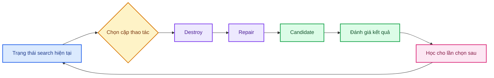
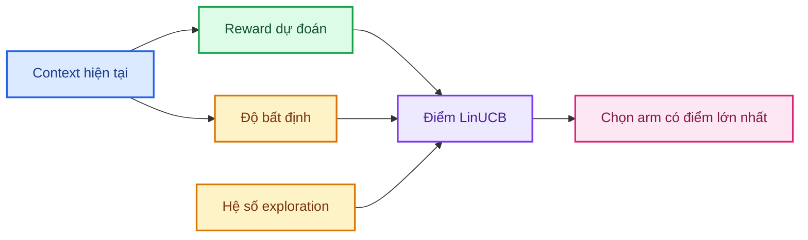
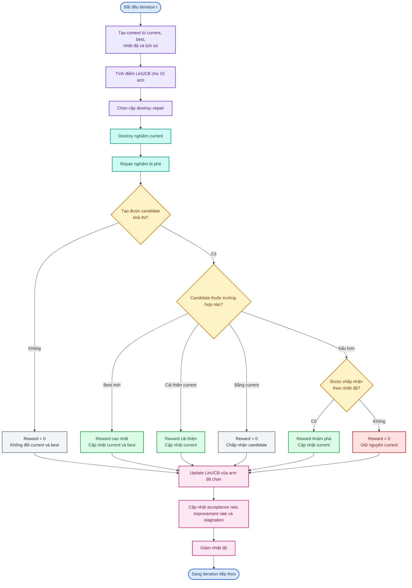
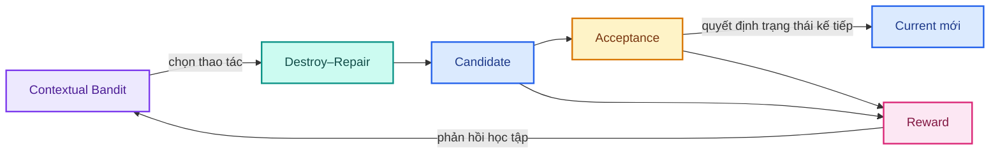

# Contextual Bandit trong ALNS

## 1. Bài toán cần giải quyết

Trong ALNS, một nghiệm mới được tạo qua hai thao tác:

1. **Destroy:** loại một số khách hàng khỏi các route hiện tại.
2. **Repair:** chèn các khách hàng đó trở lại để tạo nghiệm hoàn chỉnh.

Có nhiều cách destroy và repair. Hiệu quả của chúng không cố định trong suốt
quá trình tìm kiếm:

- đầu quá trình cần khám phá nhiều vùng nghiệm;
- khi search đình trệ cần phá nghiệm mạnh hoặc theo cách khác;
- gần cuối quá trình nên ưu tiên các thao tác có khả năng tinh chỉnh tốt;
- một destroy có thể chỉ hiệu quả khi kết hợp với một repair phù hợp.

Bài toán đặt ra là:

> Ở trạng thái hiện tại của quá trình tìm kiếm, nên chọn cặp destroy–repair nào?

Contextual Bandit được dùng để học câu trả lời qua các iteration.

## 2. Contextual Bandit là gì trong project này?

Trong project này, có thể hiểu Contextual Bandit đơn giản là **bộ phận chọn
thao tác cho ALNS**. Trước mỗi iteration, nó thực hiện ba việc:

1. đọc trạng thái hiện tại của quá trình tìm kiếm;
2. chọn một cặp destroy–repair;
3. nhận phản hồi về kết quả của cặp vừa chọn để học cho các lần sau.

Ba thuật ngữ cần hiểu là **arm**, **context** và **reward**.

### 2.1. Arm là một lựa chọn mà thuật toán có thể thực hiện

**Arm** không phải một thành phần mới của ALNS. Đây chỉ là tên gọi cho một
lựa chọn trong danh sách các lựa chọn có sẵn.

Trong project, mỗi arm là một cặp:

$$
\text{arm}=\text{một destroy}+\text{một repair}.
$$

Ví dụ:

- `(worst removal, regret-2 repair)` là một arm;
- `(route removal, greedy repair)` là một arm khác.

Khi nói “chọn arm”, ta chỉ đang nói “chọn cặp destroy–repair sẽ dùng ở
iteration này”.

### 2.2. Context là trạng thái trước khi chọn

**Context** là các thông tin mô tả tình hình search ngay trước khi chọn arm,
chẳng hạn:

- đang ở đầu hay cuối quá trình chạy;
- nhiệt độ chấp nhận đang cao hay thấp;
- đã đình trệ bao lâu kể từ lần tìm thấy best mới;
- current đang kém best bao nhiêu;
- các candidate gần đây có thường cải thiện hoặc được chấp nhận hay không.

Context cần thiết vì một cặp destroy–repair không tốt trong mọi tình huống. Khi
search đình trệ, một thao tác phá mạnh có thể hữu ích; gần cuối quá trình, một
cặp có khả năng tinh chỉnh tốt có thể phù hợp hơn.

Vì vậy, hệ thống không cố học một arm “tốt nhất cho mọi lúc”. Nó học:

> Với trạng thái hiện tại, cặp destroy–repair nào có triển vọng nhất?

### 2.3. Reward là phản hồi sau khi thực hiện lựa chọn

**Reward** là điểm phản hồi dùng để cho biết arm vừa chọn đã tạo ra kết quả hữu
ích đến mức nào. Trong cấu hình mặc định:

- tạo best mới nhận reward cao nhất;
- cải thiện current nhận reward thấp hơn;
- tạo nghiệm xấu hơn nhưng được chấp nhận nhận một reward nhỏ;
- không tạo được cải thiện hữu ích nhận reward bằng $0$.

Reward không phải objective của bài toán định tuyến. Objective dùng để so sánh
chất lượng các nghiệm; reward là tín hiệu rút gọn dùng để huấn luyện bộ chọn
arm. Cách gán reward cụ thể được trình bày ở Mục 6.

### 2.4. Một iteration diễn ra như thế nào?

Một lượt quyết định có dạng:

$$
x_t \longrightarrow a_t \longrightarrow r_t,
$$

trong đó:

- $x_t$ là context tại iteration $t$;
- $a_t$ là arm, tức cặp destroy–repair được chọn;
- $r_t$ là reward quan sát được sau khi chạy cặp đó.

Ví dụ, giả sử search đã đình trệ lâu và risk delay của current đang cao. Đây là
context. Bộ chọn quyết định dùng `(risk-priority removal, regret-2 repair)`;
đó là arm được chọn. Nếu candidate tạo ra best mới, arm nhận reward cao. Thông
tin này giúp bộ chọn ưu tiên arm đó hơn khi gặp lại trạng thái tương tự.

Chỉ kết quả của arm đã chọn được quan sát. Ta không biết các arm còn lại sẽ cho
kết quả gì ở cùng iteration, vì chúng không được chạy. Bởi vậy thuật toán vẫn
cần cân bằng giữa:

- **exploration:** thử lựa chọn còn ít dữ liệu;
- **exploitation:** ưu tiên lựa chọn đang được dự đoán tốt.

## 3. Danh sách arm trong project

Một arm là một cặp gồm một destroy và một repair:

$$
a=(d_i,r_j).
$$

Project có năm destroy và ba repair, tạo thành:

$$
5\times3=15\text{ arm}.
$$

### 3.1. Destroy

| Destroy | Ý tưởng |
|---|---|
| Random removal | Loại ngẫu nhiên một số khách hàng. |
| Worst removal | Ưu tiên loại khách hàng đang gây chi phí lớn. |
| Related removal | Loại nhóm khách hàng tương đồng về vị trí, thời gian, demand và risk. |
| Route removal | Loại toàn bộ khách hàng của một route. |
| Risk-priority removal | Ưu tiên loại khách hàng có mức rủi ro cao để sắp xếp lại. |

### 3.2. Repair

| Repair | Ý tưởng |
|---|---|
| Greedy repair | Luôn thực hiện phép chèn khả thi tốt nhất ở thời điểm hiện tại. |
| Regret-2 repair | Ưu tiên khách hàng sẽ chịu thiệt hại lớn nếu bỏ lỡ vị trí tốt nhất. |
| Risk-priority repair | Ưu tiên chèn khách hàng có risk priority cao và deadline sớm. |

Việc học theo **cặp** rất quan trọng. Ví dụ, worst removal có thể hiệu quả khi
đi với regret-2 repair nhưng không hiệu quả bằng khi đi với greedy repair. Nếu
học destroy và repair độc lập, sự tương tác này bị mất.

Kích thước phá nghiệm $q$ vẫn được lấy ngẫu nhiên trong khoảng cấu hình. Nó
không phải một phần của arm, do đó bandit hiện chỉ học **cách phá và cách sửa**,
chưa học **mức độ phá**.

## 4. Context biểu diễn trạng thái search

Trước mỗi lần chọn arm, trạng thái search được biểu diễn bằng vector chín chiều:

$$
x_t=[1,p_t,\tau_t,s_t,\rho^{acc}_t,\rho^{imp}_t,g^K_t,g^F_t,R(S_t)].
$$

| Feature | Ý nghĩa |
|---|---|
| Bias | Hằng số $1$, giúp mô hình học mức reward nền của mỗi arm. |
| Progress | Search đã sử dụng bao nhiêu phần ngân sách iteration. |
| Temperature | Mức sẵn sàng chấp nhận nghiệm xấu hơn. |
| Stagnation | Mức độ đình trệ kể từ lần gần nhất có best mới. |
| Acceptance rate | Tỷ lệ candidate được chấp nhận gần đây. |
| Improvement rate | Tỷ lệ candidate cải thiện current gần đây. |
| Vehicle gap | Current đang dùng nhiều UAV hơn best bao nhiêu. |
| Objective gap | Current kém best bao nhiêu khi hai nghiệm có cùng số UAV. |
| Risk delay | Mức độ trễ có trọng số rủi ro của current. |

### 4.1. Tiến độ

Với $t$ bắt đầu từ $0$ và tổng số iteration là $T$:

$$
p_t=\frac{t}{\max(1,T-1)}.
$$

Giá trị gần $0$ biểu thị đầu quá trình, gần $1$ biểu thị cuối quá trình.

### 4.2. Nhiệt độ

Nhiệt độ được chuẩn hóa theo thang logarithm:

$$
\tau_t=
\frac{\log(T_t)-\log(T_{\min})}
     {\log(T_0)-\log(T_{\min})}.
$$

Giá trị được giới hạn trong $[0,1]$. Nhiệt độ cao cho phép search khám phá rộng
hơn; nhiệt độ thấp khiến quá trình chọn lọc candidate chặt chẽ hơn.

### 4.3. Stagnation và lịch sử gần đây

Nếu $h_t$ là số iteration kể từ best mới gần nhất và $W$ là
`context_window`:

$$
s_t=\min\left(1,\frac{h_t}{W}\right).
$$

Acceptance rate và improvement rate cũng chỉ dùng tối đa $W$ iteration gần
nhất. Nhờ đó, context phản ánh tình hình gần đây thay vì bị toàn bộ lịch sử cũ
làm mờ.

Ở iteration đầu tiên chưa có lịch sử, hai tỷ lệ này bằng $0$.

### 4.4. Khoảng cách giữa current và best

Project so sánh nghiệm theo thứ tự từ điển:

$$
\operatorname{Score}(S)=(K(S),F(S)),
$$

trong đó $K(S)$ là số UAV và $F(S)$ là objective kết hợp khoảng cách với risk
delay. Giảm số UAV luôn được ưu tiên trước giảm $F(S)$.

Khoảng cách số UAV là:

$$
g^K_t=
\frac{\max(0,K(S_t)-K(S_{best}))}{\max(1,K_{max})}.
$$

Chỉ khi current và best có cùng số UAV mới xét khoảng cách objective:

$$
g^F_t=
\min\left(
1,
\frac{\max(0,F(S_t)-F(S_{best}))}
     {\max(|F(S_{best})|,10^{-12})}
\right).
$$

Nếu số UAV khác nhau thì $g^F_t=0$, tránh trộn hai tầng ưu tiên của objective.

## 5. LinUCB học như thế nào?

Project sử dụng **Disjoint LinUCB**. Mỗi arm $a$ có một mô hình tuyến tính riêng
với ma trận $A_a$ và vector $b_a$.

Ban đầu:

$$
A_a=\lambda I,
\qquad
b_a=0.
$$

Mô hình giả định expected reward của arm thay đổi gần tuyến tính theo context:

$$
\mathbb{E}[r_t\mid x_t,a]\approx x_t^T\theta_a.
$$

### 5.1. Dự đoán reward

Ước lượng tham số của arm:

$$
\hat\theta_a=A_a^{-1}b_a.
$$

Reward dự đoán tại context hiện tại:

$$
x_t^T\hat\theta_a.
$$

### 5.2. Đo độ bất định

Độ bất định của arm tại context hiện tại được biểu diễn bởi:

$$
\sqrt{x_t^TA_a^{-1}x_t}.
$$

Arm ít được thử ở những context tương tự sẽ có độ bất định lớn hơn.

### 5.3. Điểm LinUCB

LinUCB kết hợp reward dự đoán và phần thưởng khám phá:

$$
u_{t,a}=
x_t^T\hat\theta_a+
\alpha_{ucb}\sqrt{x_t^TA_a^{-1}x_t}.
$$

- $\alpha_{ucb}$ nhỏ: thiên về exploitation.
- $\alpha_{ucb}$ lớn: thiên về exploration.
- Khi các arm có điểm bằng nhau, một arm được chọn ngẫu nhiên theo seed.

Ở những iteration đầu, các arm chưa có dữ liệu nên có điểm gần như nhau. Sau
mỗi lần thử, reward quan sát được làm các mô hình dần khác biệt.

## 6. Reward trong quá trình học

Sau khi destroy và repair tạo candidate, candidate được so với current và best.

| Kết quả | Raw reward mặc định |
|---|---:|
| Tạo best mới | $20$ |
| Tốt hơn current nhưng chưa tốt hơn best | $10$ |
| Xấu hơn current nhưng được chấp nhận | $2$ |
| Bằng current, bị từ chối, không khả thi hoặc repair thất bại | $0$ |

Trước khi cập nhật LinUCB, raw reward được chuẩn hóa:

$$
r_t=
\frac{r_t^{raw}}
     {\max(\text{reward}_{best},
           \text{reward}_{improve},
           \text{reward}_{accepted})}.
$$

Với cấu hình mặc định, reward học được là $1$, $0.5$, $0.1$ hoặc $0$.

Reward cho nghiệm xấu hơn nhưng được chấp nhận không có nghĩa nghiệm đó tốt.
Nó ghi nhận giá trị khám phá: candidate giúp search rời khỏi trạng thái hiện tại
và có thể mở đường tới vùng nghiệm tốt hơn.

Chỉ arm vừa được sử dụng nhận cập nhật:

$$
A_a\leftarrow A_a+x_tx_t^T,
$$

$$
b_a\leftarrow b_a+r_tx_t.
$$

Các arm còn lại không được cập nhật vì không quan sát được reward của chúng.

## 7. Flow đầy đủ của một iteration

Điểm cần nhớ về thứ tự:

1. Context được tạo **trước** khi chọn arm.
2. Reward chỉ xuất hiện **sau** khi candidate được tạo và đánh giá.
3. Context hiện tại đi cùng reward của chính arm được chọn tại context đó.
4. Outcome của iteration hiện tại chỉ ảnh hưởng context từ iteration sau.

Thứ tự này ngăn việc dùng thông tin tương lai để đưa ra quyết định hiện tại.

## 8. Acceptance và learning là hai cơ chế khác nhau

Contextual Bandit quyết định **dùng cặp toán tử nào**. Cơ chế acceptance quyết
định **candidate có thay current hay không**. Hai quyết định liên quan nhưng
không thay thế nhau.

Với score $(K,F)$:

- ít UAV hơn luôn được chấp nhận;
- nhiều UAV hơn luôn bị từ chối;
- cùng số UAV và $F$ nhỏ hơn luôn được chấp nhận;
- cùng số UAV nhưng $F$ lớn hơn được chấp nhận với xác suất

$$
P(\text{accept})=
\exp\left(-\frac{F_{candidate}-F_{current}}{T}\right).
$$

Khi nhiệt độ cao, xác suất chấp nhận nghiệm xấu hơn lớn hơn. Khi nhiệt độ giảm,
search dần chuyển từ khám phá sang tinh chỉnh.

## 9. Mô hình học được điều gì?

Sau nhiều iteration, mỗi arm có thể hình thành xu hướng như:

- hiệu quả ở đầu search nhưng ít hữu ích về cuối;
- phù hợp khi stagnation cao;
- thường cải thiện khi current và best có cùng số UAV;
- hữu ích khi risk delay đang cao;
- chủ yếu tạo candidate được chấp nhận để tăng đa dạng thay vì tạo best ngay.

Bandit không ghi nhớ các luật này dưới dạng câu chữ. Chúng được biểu diễn bằng
các hệ số tuyến tính của từng arm. Vì mỗi arm có mô hình riêng, cùng một feature
có thể ảnh hưởng khác nhau tới các cặp toán tử khác nhau.

Ví dụ, nếu một arm thường nhận reward tốt khi stagnation cao, hệ số liên quan
tới stagnation của arm đó có xu hướng tăng. Lần sau khi search đình trệ, phần
reward dự đoán của arm có thể lớn hơn và arm có cơ hội được chọn cao hơn.

## 10. Những giới hạn cần hiểu

- Bandit được học lại từ đầu ở mỗi run, chưa chuyển tri thức giữa các instance.
- Quan hệ giữa context và reward được giả định gần tuyến tính.
- Các arm có mô hình độc lập nên không chia sẻ trực tiếp dữ liệu với nhau.
- Reward chỉ có vài mức rời rạc, không phản ánh độ lớn của cải thiện.
- Reward đánh giá tác động tức thời, chưa đo đầy đủ lợi ích dài hạn của một bước
  khám phá.
- Dữ liệu cũ không bị giảm trọng số; mô hình chưa có cơ chế forgetting.
- Bandit chưa chọn kích thước phá nghiệm $q$.
- Đây vẫn là tối ưu trên instance tĩnh. “Contextual” không đồng nghĩa với risk
  map, deadline hoặc task thay đổi online.

## 11. Tóm tắt

Toàn bộ cơ chế có thể ghi nhớ bằng chuỗi sau:

$$
\boxed{
\text{Quan sát trạng thái}
\rightarrow
\text{chọn cặp toán tử}
\rightarrow
\text{tạo candidate}
\rightarrow
\text{nhận reward}
\rightarrow
\text{cập nhật LinUCB}
}
$$

Contextual Bandit không thay thế ALNS. Nó là bộ điều khiển học cách chọn
destroy–repair phù hợp với trạng thái search. ALNS vẫn chịu trách nhiệm tạo và
đánh giá nghiệm; LinUCB sử dụng phản hồi từ ALNS để cải thiện quyết định chọn
toán tử qua thời gian.
